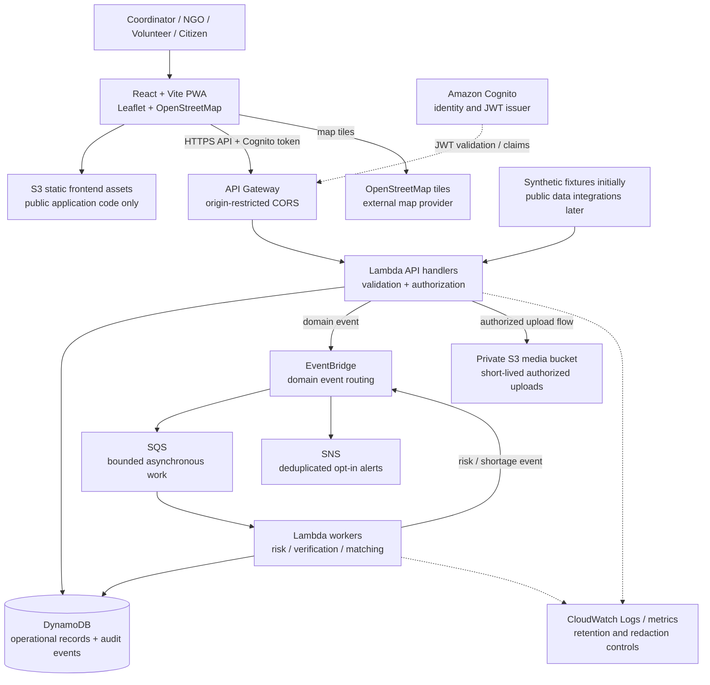

# LIFEGRID Architecture

## Scope and Constraints

The first release targets urban flood early action. The system is serverless on AWS when deployed, but the domain logic and demo workflow must run locally without AWS. Initial scenario data is synthetic and visibly labeled. Deterministic formulas make risk and demand calculations reproducible and auditable; AI services are optional enhancements and do not control critical numerical decisions.

This architecture is a proposal, not a deployed system. AWS account-specific Free Tier status, regional availability, security controls, and cost estimates must be verified before provisioning.

## Logical Architecture



The static application and citizen media are separate storage concerns. The media bucket must remain private with Block Public Access enabled. Static hosting must contain only public client assets and no secrets; the final hosting choice and its exposure/cost trade-offs must be reviewed during infrastructure design. A private S3 origin with a CDN may be evaluated, but is not assumed free or required for local development.

## Request and Event Flows

1. The client obtains identity through Cognito when authentication is enabled and sends a bearer token to API Gateway. Backend handlers validate token claims and enforce roles; a client-provided role is never authoritative.
2. An API Lambda validates input, persists the accepted record, and emits a domain event. Writes that require reliable event delivery must use an explicit persistence/outbox or retry strategy; a best-effort second write is not considered durable event delivery.
3. EventBridge routes suitable work to SQS and worker Lambdas. Queues need bounded retries, a dead-letter path, idempotent consumers, and alarms appropriate to the deployment budget.
4. Deterministic risk, need, and allocation engines produce explainable results. Human coordinators review recommendations before consequential action.
5. SNS delivery is opt-in and deduplicated with a documented cooldown. No alert is sent merely because a synthetic simulation ran unless the operator has explicitly enabled demo notifications.
6. Important state changes produce auditable actor, action, resource, timestamp, reason, and before/after values. Logs must not contain credentials, bearer tokens, or unnecessary sensitive report details.

## Domain Boundaries

Keep hazard-specific input normalization separate from shared domain services. The initial flood adapter feeds common incident, zone, report, resource, shelter, hospital, alert, action-plan, and audit concepts. Future hazard adapters may add hazard-specific measures without changing the common authorization, event, and audit boundaries.

The planned deterministic pipeline is:

```text
synthetic / approved inputs -> validation -> flood risk score -> need estimate
    -> resource matching -> proposed early actions -> human review -> audit
```

Every score and estimate should retain its input values, formula/version, timestamp, and explanation so an operator can reproduce why it was produced.

## Explainable Flood MVP Risk Model

This deterministic model is an MVP decision-support heuristic. It is **not scientifically validated**, an official forecast, or an emergency warning. Its weights and normalization constants are versioned in `backend/config.py` under model version `flood-mvp-v1`.

Each input is converted to a risk-oriented score from 0 to 100:

| Factor | Normalization | Weight |
|---|---|---:|
| Rainfall | `min(rainfall_mm / 300, 1) * 100` | 0.25 |
| River level | LOW=15, MEDIUM=45, HIGH=75, CRITICAL=100 | 0.20 |
| Population density | `min(people_per_km2 / 10,000, 1) * 100` | 0.15 |
| Road accessibility | `100 - accessibility_percent` | 0.10 |
| Shelter capacity | `100 - adequacy_percent` | 0.10 |
| Medical capacity | `100 - adequacy_percent` | 0.10 |
| Historical risk | Input index, 0 to 100 | 0.10 |

The weighted score is the sum of each normalized risk multiplied by its weight (weights total 1.00), rounded to an integer and bounded to 0–100. LOW is 0–30, MEDIUM 31–60, HIGH 61–80, and CRITICAL 81–100. The response includes each normalized value, weight, weighted contribution, factor rating, and a plain-language reason. Availability percentages are coarse scenario inputs, not measured inventory or service coverage.

## Demand and Affected-Population Assumptions

Default one-day planning assumptions are 3 litres of water per affected person, 1 food kit per person, 0.05 medical units per person, and 0.30 shelter spaces per person. Fractional item/space counts are rounded up; water is retained to two decimal places. The simulation estimates affected population as `ceil(total_population * min(risk_score * 0.005, 0.50))`, bounded by the total population. These configurable MVP assumptions are illustrative, not official or medically validated requirements. They are returned with each simulation result.

## Citizen Reports (Phase 4)

`backend/models/report.py` validates category, title/description size, coordinate ranges, severity 1–5, affected population, source, and status. Report IDs and UTC timestamps are generated server-side. Report fields include `report_id`, `category`, `title`, `description`, `latitude`, `longitude`, `severity`, `people_affected`, `timestamp`, `status`, `source`, `priority_score`, `priority_level`, `priority_explanation`, nearest-zone `location_risk_score`, `possible_duplicate`, `duplicate_report_ids`, and status history. Categories are FLOOD, ROAD_BLOCK, MEDICAL, SHELTER, FOOD, WATER, FIRE, OTHER; statuses are RECEIVED, VALIDATING, VERIFIED, DISPATCHED, RESOLVED, REJECTED; sources are CITIZEN and SIMULATION.

Priority uses severity score `severity * 20`; affected-person score `min(100, log1p(people_affected) / log1p(1000) * 100)`; fixed category urgency (MEDICAL=100, FIRE=95, FLOOD=90, SHELTER=75, ROAD_BLOCK=70, WATER=65, FOOD=60, OTHER=45); and nearest synthetic-zone risk score. Weights are severity 0.40, people 0.25, category 0.20, location 0.15. The weighted sum is rounded and categorized LOW 0–30, MEDIUM 31–60, HIGH 61–80, CRITICAL 81–100. Responses include contributions and identify the result as a LIFEGRID MVP decision-support heuristic, not scientifically validated.

Possible duplicates are flagged, never automatically removed. The heuristic requires matching category, severity within one level, an active status, a six-hour time window, distance within 500 m, and title-plus-description similarity of at least 0.68. These configurable thresholds are not proof of identity or truth. Status changes follow `RECEIVED -> VALIDATING -> VERIFIED -> DISPATCHED -> RESOLVED`, with REJECTED allowed from RECEIVED, VALIDATING, and VERIFIED. Invalid transitions return 409. Status changes append actor, reason, and time history. Explicit DELETE is available for local test data; production retention policy is future work.

## Resource Matching and Allocation (Phase 5)

`backend/models/resource.py` validates resource type/status, coordinates, non-negative available quantity, positive capacity, and available quantity not above capacity. Each resource has `resource_id`, `type`, `name`, coordinates, baseline `available_quantity`, `unit`, `capacity`, and `status`. Types are WATER, FOOD, MEDICINE, SHELTER, AMBULANCE; statuses are AVAILABLE, LIMITED, EXHAUSTED, UNAVAILABLE. Requirements use configurable assumptions in `backend/config.py`: 3 L water/person/day, 1 food kit/person/day, 0.05 medicine units/person/day, 0.30 shelter spaces/person, and one ambulance per 2,500 people. Each requirement is `ceil(affected_population * assumption)`; responses carry the assumptions and formula.

Matching uses Haversine distance and filters for the selected type, AVAILABLE/LIMITED stock, and a risk-dependent radius (LOW 100 km, MEDIUM 150 km, HIGH 200 km, CRITICAL 250 km). Candidates sort nearest-first, then greater available stock, then stable resource ID; recommendations are greedy until demand is met or stock ends. Results explain distance, stock, recommended quantity, and remaining shortage. This is the **LIFEGRID MVP resource matching heuristic**, not globally optimal optimization. With a report ID, the backend uses stored report location, affected population, and priority instead of trusting client-supplied incident context.

Allocation rejects unknown, EXHAUSTED, UNAVAILABLE, non-positive, and over-available quantities. Current inventory is derived from the synthetic resource baseline minus append-only allocation records. A process-wide thread lock serializes check-and-append inside one Python process; atomic replacement reduces partial-file risk. Derived inventory cannot become negative. Allocation responses include remaining stock and the calculated unmet demand for the linked incident or aggregate active reports. Local JSON files are not operational inventory or distributed transactional storage.

## Phase 4/5 API Surface

All routes use `{ "success": true, "data": ... }`; errors use `{ "success": false, "error": { "code", "message", "details?" } }`. Validation is 422, missing records 404, invalid workflow/inventory conflicts 409, and local data failures structured 500 responses.

| Method | Path | Purpose |
|---|---|---|
| POST | `/api/v1/reports` | Create report with server-generated ID/time, priority, and duplicate flags |
| GET | `/api/v1/reports` | List local reports |
| GET | `/api/v1/reports/{report_id}` | Retrieve one report |
| PATCH | `/api/v1/reports/{report_id}/status` | Validated status transition with history |
| DELETE | `/api/v1/reports/{report_id}` | Explicit local report removal |
| GET | `/api/v1/resources` | List resources with allocation-adjusted availability |
| GET | `/api/v1/resources/{resource_id}` | Retrieve one resource |
| GET | `/api/v1/resources/summary` | Active-report requirements and coverage |
| GET | `/api/v1/resources/shortages` | Resource types below modeled aggregate need |
| GET | `/api/v1/resources/allocations` | Read append-only allocation history |
| POST | `/api/v1/resources/requirements` | Calculate needs for an affected population |
| POST | `/api/v1/resources/match` | Recommend nearby available stock |
| POST | `/api/v1/resources/allocate` | Confirm one allocation |

## Phase 6 Local Domain Events

`backend/events/event_models.py` defines versionable domain event data with unique IDs, event type, source, UTC timestamp, optional report/severity/location, and a JSON payload. `EventBus` is the publisher contract. Local mode persists event history to `backend/data/events.json`; handler outcomes are recorded in `processed_events.json`, and handler failures in `failed_events.json`.

The local report-created path is `REPORT_CREATED -> RiskProcessor -> RISK_ASSESSED -> ResourceProcessor -> RESOURCE_SHORTAGE` when modeled stock is insufficient. The report is updated with risk, requirements, shortage results, and processing state. Report verification, resolution, and allocations publish `REPORT_VERIFIED`, `INCIDENT_RESOLVED`, and `RESOURCE_ALLOCATED` respectively. Child event IDs are deterministically derived from their parent IDs. The local handler ledger keys successful work by event ID and handler; duplicate deliveries are ignored. Failed handlers are retried up to the configured local attempt limit and each failed attempt is recorded.

This event bus is a local synchronous implementation. `EventBridgeEventBus` can publish to a named bus, but deployed Lambda consumers, DynamoDB-backed persistence, retry/DLQ behavior, and a validated SAM stack are not implemented or verified. JSON idempotency is process-local and is not suitable for distributed AWS workers.

## Local JSON Data Safety and Limitations

Reports and allocations persist in `backend/data/reports.json` and `backend/data/allocations.json`; `backend/data/resources.json` is the synthetic stock baseline. Missing/empty files default safely to empty collections. Corrupt/unreadable JSON returns a structured error. Updates use a process-wide reentrant lock and atomic temp-file replacement. This does not coordinate multiple processes or machines: run one Uvicorn worker only. Authentication, real citizen identity, media upload, certified verification, authoritative inventory, and emergency guidance are not implemented. All fixtures are fictional synthetic demo data.

## Data and Trust Boundaries

- Browser input is untrusted. Validate schema, size, timestamps, coordinates, category, severity, and authorization server-side.
- Citizen reports are unverified evidence. Duplicate proximity and cross-report consistency can influence an MVP confidence score but do not establish truth.
- Uploaded files require size/type validation and private storage. Use a short-lived, object-scoped upload authorization flow; do not expose bucket credentials or public object URLs.
- DynamoDB access is through narrowly scoped service roles. Table keys and indexes will be finalized with access patterns before infrastructure is deployed.
- External weather, population, or emergency feeds are future integrations and must record source, retrieval time, licensing/terms, and freshness.
- OpenStreetMap is an external tile service; follow its usage policy and do not imply guaranteed availability or use it as an emergency-grade map source.

## Resilience and Cost Controls

Local mock mode must work without AWS or external feeds. The PWA may cache the app shell and queue drafts locally, but must clearly indicate offline state and sync failures; this is not emergency-grade offline reliability.

Use on-demand/serverless options where appropriate, short log retention, bounded event retries, payload limits, conservative polling, and explicit quotas/rate limits. Avoid NAT Gateways, RDS, always-on compute, EKS, paid map APIs, and managed generative inference in the MVP. These choices reduce expected cost but do not guarantee a zero bill. Refer to [FREE_TIER_SAFETY.md](FREE_TIER_SAFETY.md).

## Observability and Operations

Use structured logs with request/correlation IDs, redaction, and controlled retention. Track API errors/latency, queue age and failures, worker outcomes, notification deduplication, and audit-write failures. Alarms and log ingestion can incur charges; deploy only after estimating and setting billing alerts. Define operator-visible degraded states rather than silently treating stale inputs as current.

